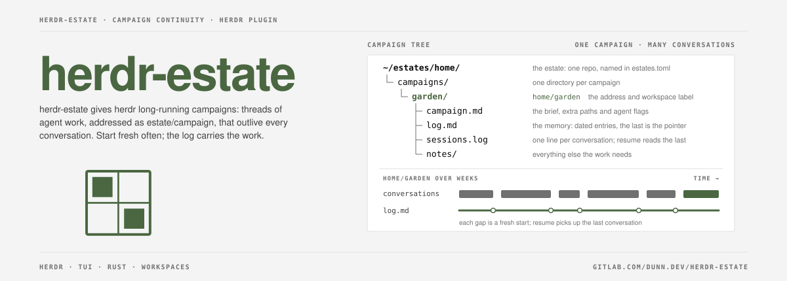
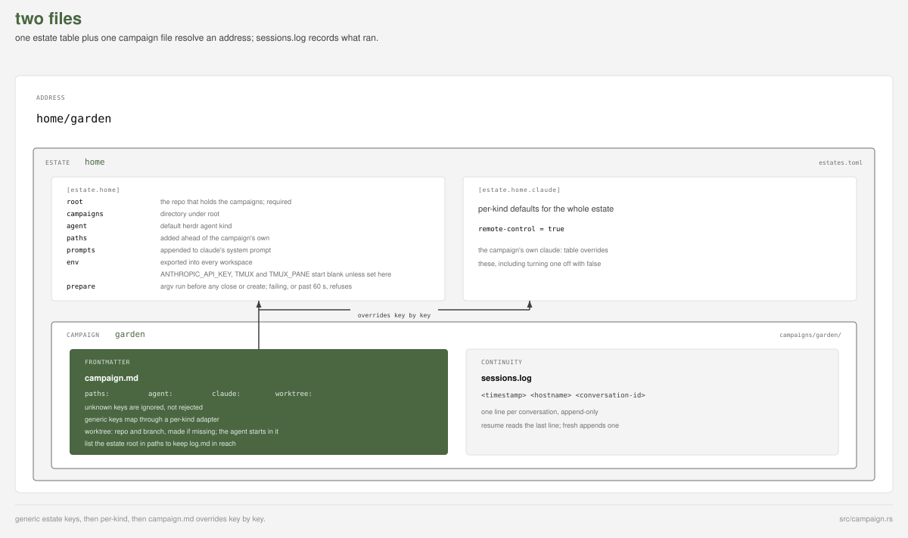
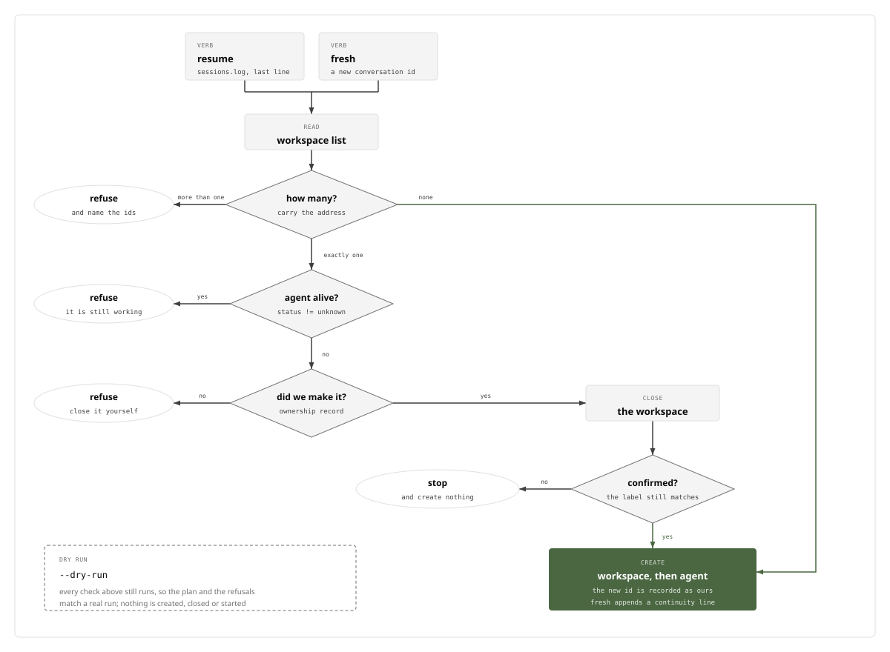

# dunn.dev/herdr-estate

[](https://gitlab.com/dunn.dev/herdr-estate/-/pipelines)
[](LICENSE)


herdr-estate is a plugin for the [herdr](https://herdr.dev) terminal
workspace manager. It gives herdr *estates* and *campaigns*: long-running
threads of agent work, addressed as `estate/campaign`, that outlive any
one conversation. The plugin reads two files, keeps its own continuity
log, and can create campaigns; herdr's own resume is never used.

## Install

```sh
cargo build --release
herdr plugin link /path/to/herdr-estate
```

`plugin link` never runs the manifest's `[[build]]`, so build first; a
rebuild takes effect on herdr's next invocation. `herdr plugin install`
runs `[[build]]` itself. Then bind the picker to a free key in
`~/.config/herdr/config.toml`:

```toml
[[keys.command]]
key = "prefix+shift+e"
type = "plugin_action"
command = "herdr-estate.pick"
```

`resume` and `fresh` are actions too, bound the same way.

## The two files



**The estate table**, `estates.toml`, lives at
`$HERDR_PLUGIN_CONFIG_DIR/estates.toml` under herdr, or
`~/.config/herdr-estate/estates.toml` from a bare shell:

```toml
[estate.home]
root = "~/estates/home"
campaigns = "campaigns"
agent = "claude"
paths = ["~/code"]
prompts = ["prompts/base.md"]
env = { }

[estate.home.claude]
remote-control = true
```

**The campaign file**, `campaigns/<name>/campaign.md`, carries YAML
frontmatter:

```yaml
paths: [~/code/a, ~/code/b]   # extra directories the agent may work in
agent: claude
claude:
  remote-control: true
  mcp-config: .mcp.json
```

A relative `prompts` or `paths` entry resolves against the estate's
`root` once `~` and `$VAR` expand, and a path in both files is kept
once. The shipped adapter is `claude`; any other `agent` starts with no
mapped flags and one warning. `campaigns/<name>/sessions.log` holds one
line per conversation; `resume` with none recorded acts as `fresh` and
says so. See [`examples/`](examples/) and
[`docs/vocabulary.md`](docs/vocabulary.md).

## Worktrees (optional)

```yaml
worktree:
  repo: ~/code/site     # the repository to take a worktree of
  branch: wt/site-work  # created from the remote default branch if missing
```

With this key, `resume` and `fresh` ensure the worktree exists, use it
as the workspace cwd, and add it to the agent's paths. herdr-estate
never removes a worktree; that stays a human act. It uses plain git
because `herdr worktree` takes no `--env` and registers a stray base
workspace.

## Environment

An agent inherits the environment of its workspace's shell, which the
herdr server spawns, so start the server from a clean shell. On every
`workspace create`, herdr-estate empties `ANTHROPIC_API_KEY`, `TMUX`
and `TMUX_PANE`, then adds the estate's `env` table, which may set them
again. No other variable is touched.

## The verbs



- `herdr-estate resume [<address>]`: continue the campaign's latest
  conversation in a new workspace.
- `herdr-estate fresh [<address>]`: retire the latest conversation and
  start a new one in the same space.
- `herdr-estate list`: list every campaign the estate table knows.
- `herdr-estate create <address> --brief <text>`: write a new
  campaign's `campaign.md` and `log.md`, uncommitted; no herdr call.

With no `<address>`, the current workspace's label is used.
`--dry-run` prints the plan for `resume`, `fresh` or `create` after
the same reads and guards and changes nothing; it needs an explicit
`<address>`. Each step prints to stderr and every run appends to
`events.log`; see [docs/events.md](docs/events.md).

## Long-running campaigns

A campaign is long-running; its conversations should be short. A
conversation costs more per turn as its context grows, so recycle it
often: have the agent write where things stand into the campaign's log,
exit it, then run `fresh` (ctrl+f in the picker). The new conversation
carries nothing over, so the estate's `prompts` should point it at
`campaign.md` and the log's latest entry. `resume` is for the
conversation you meant to keep. Every retired conversation stays in
`sessions.log`.

## Picker

`herdr-estate pick` lists every campaign the table knows, with the
first body line of its `campaign.md`:

- **live**: a workspace carries the address; its agent status shows.
- **dormant**: no workspace, but `sessions.log` records a
  conversation; its last date shows.
- **new**: neither.

Live rows sort first, then dormant by most recent, then new. Type to
filter; the footer lists the keys. Enter focuses the row's
workspace, first resuming a dormant campaign or starting a new one
fresh. It re-reads the workspace and goes through the same verbs and
guards as the CLI. A filter `estate/name` naming no campaign offers
`+ create`: Enter, a one-line brief, and Enter again create it and
start it fresh. Colours and glyphs follow herdr's config, though
`auto_switch` always shows the dark theme.

It opens as a popup from the key bound above, or by hand:

```sh
herdr plugin pane open --plugin herdr-estate --entrypoint picker
```

herdr runs an action with no terminal, so the `pick` action makes that
call. `pick --render-once --width <W> --height <H>` prints one frame as
plain text (default 80x20).

## Worked example

Using the invented names in [`examples/`](examples/):

```sh
export HERDR_PLUGIN_CONFIG_DIR=$(mktemp -d)
cp examples/estates.toml "$HERDR_PLUGIN_CONFIG_DIR/estates.toml"
# point its `root` at examples/home in a clone of this repo

cargo build --release
target/release/herdr-estate list
# home/garden                 new
# home/taxes                  new

target/release/herdr-estate fresh home/garden --dry-run
# would create:
#   herdr workspace create --cwd ... --label home/garden ...
# would start:
#   herdr agent start home-garden --kind claude --pane <PANE_ID> ...
```

## Tests

```sh
cargo fmt --check
cargo clippy --all-targets -- -D warnings
cargo test
```

Everything crossing the herdr CLI boundary runs against a fake `herdr`
(`$HERDR_BIN_PATH`) that records each call's argv and environment and
replays canned responses. The suites in `tests/` drive the built
binary.
