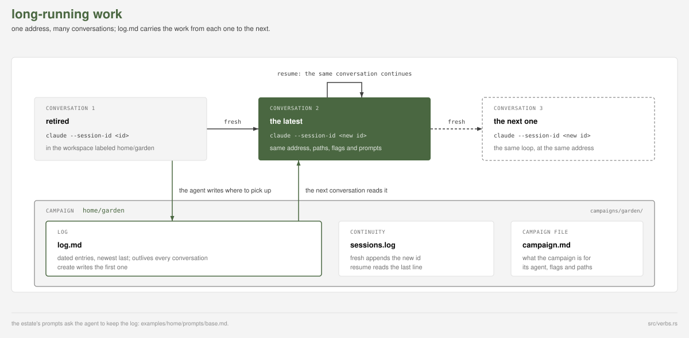
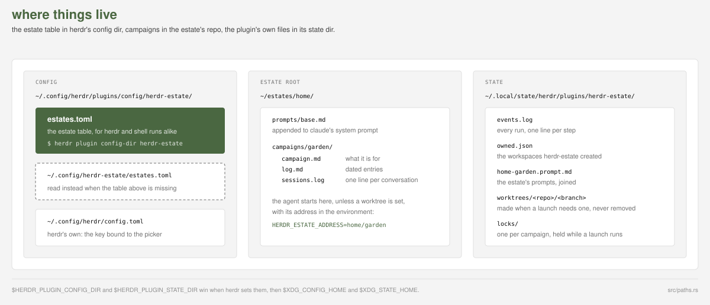
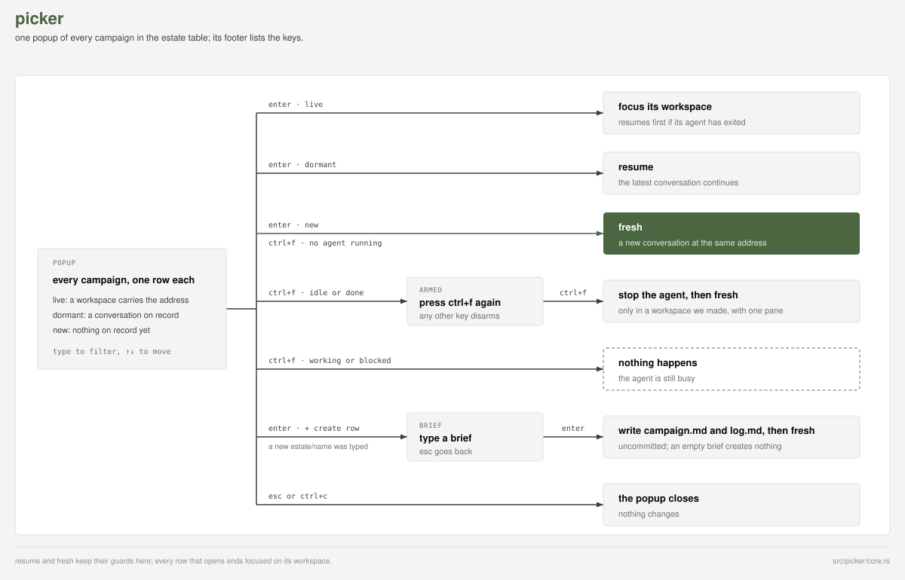

# dunn.dev/herdr-estate

[](https://gitlab.com/dunn.dev/herdr-estate/-/pipelines)
[](#license)


herdr-estate is a plugin for the [herdr](https://herdr.dev) terminal
workspace manager: long-running campaigns, threads of agent work
addressed as `estate/campaign`, that outlive every conversation. Each
word is defined once in [docs/vocabulary.md](docs/vocabulary.md).

## Long-running work



A conversation costs more per turn the longer it runs, so recycle
often. The estate's `prompts` teach the agent to keep the log
([example](examples/home/prompts/base.md)).

## Install

Needs herdr 0.9.1+, macOS or Linux, and Rust 1.89+; herdr builds the
plugin on install.

```sh
herdr plugin install andrewdunndev/herdr-estate
```

Bind the picker to a free key in `~/.config/herdr/config.toml`:

```toml
[[keys.command]]
key = "prefix+shift+e"
type = "plugin_action"
command = "herdr-estate.pick"
```

For shell use, `cargo install --locked --git https://github.com/andrewdunndev/herdr-estate`
or a [release binary](https://gitlab.com/dunn.dev/herdr-estate/-/releases)
puts `herdr-estate` on your PATH.

## Configure




```toml
[estate.home]
root = "~/estates/home"
```

[examples/](examples/) is an annotated estate.

## Picker



## Verbs


`herdr-estate --help` lists the verbs and their flags, and
[docs/events.md](docs/events.md) the progress lines they print.

## Develop

Review, CI and releases run on
[GitLab](https://gitlab.com/dunn.dev/herdr-estate);
[GitHub](https://github.com/andrewdunndev/herdr-estate) is a mirror.
Issues are welcome on either.

```sh
cargo build --release && herdr plugin link "$PWD"
cargo fmt --check && cargo clippy --release --all-targets --all-features -- -D warnings && cargo test
```

## License

MIT, in [LICENSE](LICENSE), except `src/picker/theme.rs`, adapted from
herdr under Apache-2.0, in [LICENSE-APACHE-HERDR](LICENSE-APACHE-HERDR).

---

Built by Andrew Dunn, 2026.
